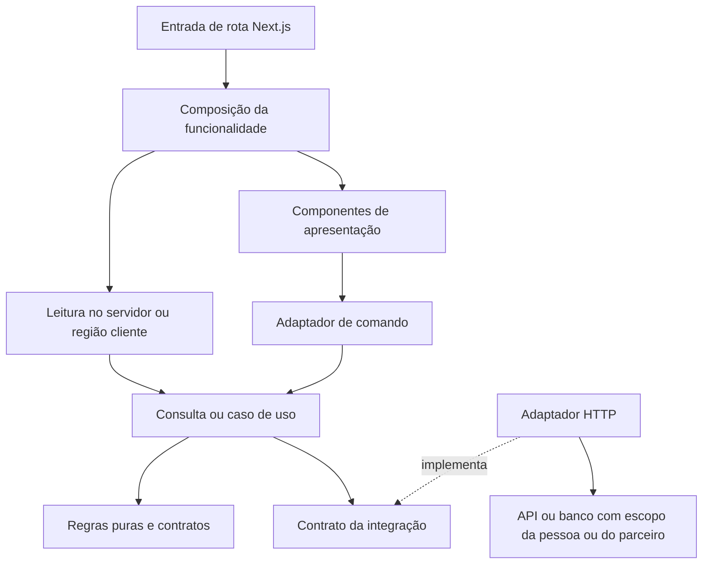

# Achados na Rota — princípios de arquitetura do frontend

**Data:** 16/10/2026, atualizado em 17/10/2026 · **Etapa:** fundação adaptada ao Achados na Rota e app do assinante (F1) · **Estado:** decisões propostas para revisão.

## 1. Propósito e limites desta etapa

Construir uma base que permita mudar o produto com confiança: localizar uma responsabilidade, alterar seu comportamento, testar o resultado e entregar sem regressão. O Achados na Rota ("Descubra lugares que valem a pena.") é um PWA de descoberta de restaurantes, hospedagens e experiências, com curadoria editorial independente e passaporte anual de benefícios; lida com dados pessoais de assinantes e com a separação entre avaliação editorial e oferta comercial desde o primeiro dia.

**O produto é definido em [docs/produto](produto/README.md).** Lá estão visão, arquitetura lógica, domínio, segurança e LGPD, UI, roadmap com as fases F0–F5, API, operação comercial, supervisão e os ADRs de produto (`ADR-001` a `ADR-010`). Este documento e os [ADRs de frontend](adr/README.md) dizem como o frontend e o monorepo são construídos; não redefinem decisões de produto. Os princípios inegociáveis do produto (confiança acima de monetização editorial, autorização no servidor, dados mínimos e nada sensível em logs, resgate seguro, nenhuma avaliação ou economia fictícia em produção) valem para todo código daqui. O avanço segue as fases como portões: não avançar sem evidências verificáveis.

O monorepo reúne o app `achados-web` (o PWA do assinante, Next.js/Tailwind, [ADR-0025](adr/0025-app-pwa-do-assinante.md)), a vitrine do design system (Storybook) e a documentação de negócio (Fumadocs). A área administrativa (curadoria, parceiros, moderação) é uma aplicação futura; a casca de painel da base está no commit inicial para servir a ela. Banco em PostgreSQL com Drizzle (Docker no desenvolvimento, Neon em produção), ids em ULID ([ADR-0024](adr/0024-identificadores-ulid.md)).

Os princípios definem responsabilidades, contratos e como verificar sua aplicação. A estrutura está no [ADR-0011](adr/0011-estrutura-monorepo.md): apps na raiz, packages compartilhados, pnpm e Turborepo. Topologia de deploy e cronograma permanecem decisões posteriores. Os exemplos de funcionalidades nos ADRs continuam ilustrativos.

A base veio do monorepo Phibra.Web.Next, sem histórico git e sem o domínio do cliente de origem. O que foi reaproveitado, removido e alterado está em [origem da base](origem-da-base.md). Evidências de execução registradas na origem não valem aqui até serem refeitas.

**Diretrizes dadas pelo responsável:** Next.js + React 19 + Tailwind; responsabilidade única; componentes explícitos e compostos; Suspense + DataBoundary; Result/Error do core; prioridade ao estado HTTP; testes unitários + Playwright; decisões em ADRs; o mesmo padrão de arquitetura e princípios usado na base.

**Recomendações desta proposta:** Server Components como padrão de renderização, divisão entre leituras e comandos, critérios de adoção de TanStack Query, isolamento de cache, estratégia de testes e barreiras automáticas. Estão documentadas em ADRs com estado Proposto.

## 2. Princípios e evidências

| ID  | Princípio                               | Regra observável                                                                                                                           | Decisão                                        |
| --- | --------------------------------------- | ------------------------------------------------------------------------------------------------------------------------------------------ | ---------------------------------------------- |
| P01 | Responsabilidade única e coesão         | Um componente, módulo ou função tem um motivo principal para mudar. HTTP, regra de negócio e apresentação podem evoluir separadamente.     | [ADR-0001](adr/0001-modularidade.md)           |
| P02 | Dependências explícitas                 | Cada módulo expõe um contrato público. Aplicações não importam aplicações; UI genérica não importa domínios.                               | [ADR-0001](adr/0001-modularidade.md)           |
| P03 | React 19 por intenção                   | Usar recursos atuais onde resolvem a necessidade: servidor, Suspense, Actions, transições e assinaturas externas.                          | [ADR-0002](adr/0002-react19-e-nextjs.md)       |
| P04 | Composição explícita                    | O leitor enxerga as partes da tela no JSX. Contextos, props e callbacks têm contratos claros.                                              | [ADR-0003](adr/0003-componentes-explicitos.md) |
| P05 | Resultado e falha são parte do contrato | Operações falíveis retornam Result do core; todo consumidor trata Ok e Err. Exceções de biblioteca são adaptadas em uma fronteira nomeada. | [ADR-0004](adr/0004-result-error.md)           |
| P06 | Carregamento e recuperação por região   | Cada região assíncrona relevante tem DataBoundary, fallback e caminho de recuperação. Erro de formulário permanece no formulário.          | [ADR-0005](adr/0005-data-boundary.md)          |
| P07 | Uma fonte responsável por cada estado   | URL, formulário, UI local, cache remoto e sessão têm donos diferentes. Não sincronizar cópias de dados HTTP por efeitos.                   | [ADR-0006](adr/0006-estado-http-e-cache.md)    |
| P08 | Cache é uma política explícita          | Cada recurso define escopo, atualização e invalidação. Nenhum cache é fronteira de autorização.                                            | [ADR-0006](adr/0006-estado-http-e-cache.md)    |
| P09 | Compartilhamento por contrato           | Compartilhar capacidades estáveis; preservar autonomia de build e de deploy entre aplicações.                                              | [ADR-0007](adr/0007-monorepo-e-autonomia.md)   |
| P10 | Design system acessível                 | Tokens semânticos, Tailwind e componentes com teclado, foco e semântica preservados pela composição.                                       | [ADR-0008](adr/0008-design-system.md)          |
| P11 | Testar comportamento e risco            | Regras em testes rápidos; integração para contratos, cache e isolamento; Playwright para jornadas.                                         | [ADR-0009](adr/0009-testes.md)                 |
| P12 | A arquitetura precisa ser verificável   | ADRs, contratos, revisão e barreiras de CI impedem desvios; documentação sozinha não basta.                                                | [ADR-0010](adr/0010-governanca.md)             |

## 3. Modelo de responsabilidades

As caixas representam responsabilidades, não diretórios ou classes obrigatórias. Uma funcionalidade simples pode ter poucas funções; camadas sem comportamento não precisam de wrappers.

| Responsabilidade       | Faz                                                                             | Fronteira                                                                         |
| ---------------------- | ------------------------------------------------------------------------------- | --------------------------------------------------------------------------------- |
| Entrada Next.js        | Parâmetros de rota, metadata, composição e convenções do framework.             | Não concentra regras de negócio. Não há regra artificial de uma única importação. |
| Composição             | Expõe as regiões, fronteiras de dados e interações entre partes.                | Não implementa transporte ou cálculo de negócio. Pode existir no servidor.        |
| Apresentação           | Renderiza dados tipados, acessibilidade e interações locais.                    | Componentes reutilizáveis não conhecem endpoint, credencial ou cache.             |
| Coordenador de dados   | Conecta Query/Action, mapeamento e eventos da região.                           | Hook não vira depósito de todas as regras da tela.                                |
| Caso de uso / consulta | Coordena a operação e retorna Result.                                           | Não depende do DOM, React, Tailwind ou cache do navegador.                        |
| Domínio                | Regras, invariantes e transformações puras quando pertencem ao frontend.        | O servidor continua responsável por autorização, escopo e regras autoritativas.   |
| Integração HTTP        | Request, timeout, cancelamento, validação do contrato e normalização de falhas. | Fetch fica nesta fronteira; DTO externo não invade todo o JSX.                    |
| Core Result/Error      | Um contrato canônico e independente de framework.                               | Não importa features, Next.js, React ou TanStack Query.                           |

Dados serializáveis podem atravessar servidor e cliente. Callbacks comuns ficam dentro de uma árvore cliente; Server Functions e composição via children seguem os contratos próprios do React. Não passar instâncias de serviço, credenciais ou funções arbitrárias pela fronteira.

## 4. Regras que devem ficar evidentes no código

Uma seção de lista pode coordenar seu hook de dados e renderizar filtros, tabela, paginação e editor separados. A linha da tabela recebe dados e callbacks; não decide como autenticar ou invalidar cache. Um cálculo do domínio permanece testável sem montar um componente.

Componentizar muito significa separar responsabilidades e construir partes úteis. Uma função trivial não precisa virar um hook nem cada elemento HTML um arquivo. Contagem de linhas ajuda a localizar problemas; não comprova responsabilidade única. O [ADR-0003](adr/0003-componentes-explicitos.md) define os sinais de extração.

Estado HTTP tem vida própria: carregamento inicial, dado vazio, dado atual, atualização em segundo plano, falha inicial, falha após sucesso e resultado de uma mutação. Suspense não elimina todos esses estados. O [ADR-0005](adr/0005-data-boundary.md) define a apresentação; o [ADR-0006](adr/0006-estado-http-e-cache.md), seus donos e políticas.

## 5. Definição de pronto de uma funcionalidade

- [ ] Responsabilidades separadas e dependências seguindo contratos públicos.
- [ ] Contrato Result/Error canônico usado nas operações falíveis; nenhum Err tratado como sucesso de consulta ou mutação.
- [ ] Leitura inicial e dono da atualização definidos; uso de Query justificado pela necessidade do navegador.
- [ ] Regiões assíncronas com loading, vazio, erro e recuperação definidos; atualização em segundo plano preserva dados quando seguro.
- [ ] Filtros navegáveis na URL; dados remotos fora de stores globais de UI.
- [ ] Autorização e escopo (pessoa, parceiro) no servidor, cache isolado por contexto e payloads sem segredos.
- [ ] Nenhum dado pessoal, token, código de resgate ou segredo em log, telemetria, mensagem de erro ou URL; fixtures sintéticas.
- [ ] Teste de isolamento A/B (entre pessoas e entre parceiros) quando a funcionalidade lê ou grava dado de negócio.
- [ ] Componentes explícitos, navegação por teclado e foco verificados nas interações relevantes.
- [ ] Testes de regras, integrações e jornadas proporcionais ao risco, passando.
- [ ] ADRs aplicáveis citados; documentação e verificações atualizadas junto com a mudança.

## 6. Sequência de consolidação

1. Revisar estes princípios e os ADRs adaptados, resolver divergências com os documentos de produto e registrar a aceitação.
2. Executar neste repositório as verificações herdadas (`pnpm check`, E2E, histórias do design system) e registrar os resultados nos ADRs, sem reaproveitar os da origem.
3. Validar os contratos de [Result/Error](../packages/core/src/result.ts) e [DataBoundary](../packages/data-boundary/src/data-boundary.tsx) e tratar suas lacunas antes de torná-los referência executável. As assinaturas estão nos ADRs 0004 e 0005; não criar implementações concorrentes.
4. Identidade, sessão e isolamento por pessoa ([ADR-0020](adr/0020-autenticacao-e-sessao.md)) e catálogo com publicação no banco: implementados com testes A/B ([ADR-0025](adr/0025-app-pwa-do-assinante.md)). Falta o escopo de parceiro, com o painel do parceiro.
5. Funcionalidade vertical de referência: favoritos (leitura no servidor, Query hidratado, comando por Action com `useMutation`, invalidação, RLS e testes de unidade, integração e E2E).
6. Só então repetir o padrão por funcionalidade, um marco por vez, com aprovação humana entre os portões.

## 7. Decisões ainda abertas

| Tema                                                 | Evidência necessária                                                                                                                                                           | Quando resolver                               |
| ---------------------------------------------------- | ------------------------------------------------------------------------------------------------------------------------------------------------------------------------------ | --------------------------------------------- |
| Validação completa de Result/Error e DataBoundary    | Testes da base executados aqui; ainda faltam payloads arbitrários seguros, background, acesso revogado e streaming real.                                                       | Antes dos fluxos de produção correspondentes. |
| Escopo de parceiro e papéis (curador, administrador) | Modelo de `partner_organizations` e vínculos do documento 03, RLS por parceiro e MFA para curador e administrador ([ADR-003 de produto](produto/adr/ADR-003.md)).              | Antes do painel do parceiro (F4).             |
| Onde fica o backend                                  | Identidade e dados no app Next (Server Components, Actions e BFF em `/api`). Jobs de expiração, notificações e reconciliação de pagamentos ainda sem lugar (documento 02).     | Antes da F3 (webhooks).                       |
| Versão do Postgres em produção                       | Drizzle adotado; produção no Neon. Criar o projeto Neon com Postgres 18, igual ao Docker de desenvolvimento ([ADR-0013](adr/0013-ambientes-e-configuracao.md)).                | Antes do primeiro ambiente de homologação.    |
| Contrato real da API                                 | OpenAPI dos endpoints do documento 07, com erros sem dados sensíveis e paginação.                                                                                              | Antes do primeiro adaptador HTTP de produção. |
| Observabilidade sem dados pessoais                   | Ferramenta de logs, métricas e traces com redação de PII e IDs de correlação ([04 — Segurança](produto/04-seguranca-confidencialidade.md)).                                    | Antes do piloto (G5).                         |
| Filtros na URL × dado confidencial                   | A busca do catálogo (lugares públicos) vai para a URL; buscas sobre dados de pessoas (painel) ficam em estado local até a regra ([ADR-0006](adr/0006-estado-http-e-cache.md)). | Primeira listagem do painel.                  |
| Identidade visual no tema escuro e escala de texto   | Decisões abertas do [ADR-0022](adr/0022-identidade-visual-achados.md), conferidas com o responsável.                                                                           | Antes da primeira tela além da casca.         |
| Biblioteca de formulário                             | Complexidade dos formulários reais. RHF/Zod e primitivas acessíveis são candidatos.                                                                                            | Primeira funcionalidade de referência.        |
| Metas de CI                                          | Tempos medidos na primeira execução do GitHub Actions e jornadas críticas.                                                                                                     | Depois da primeira execução da CI.            |
| Template para outros produtos                        | Nome do repositório e forma de geração ([ADR-0023](adr/0023-scaffold-como-template.md)).                                                                                       | Antes do próximo produto.                     |

Referências técnicas oficiais estão junto às decisões que fundamentam. Não fixamos uma versão de biblioteca a partir de exemplos de outro produto.
